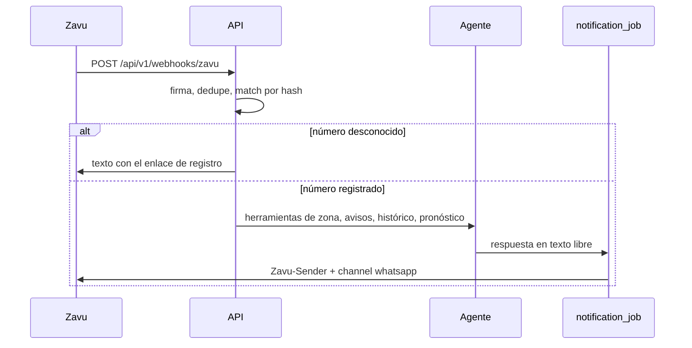
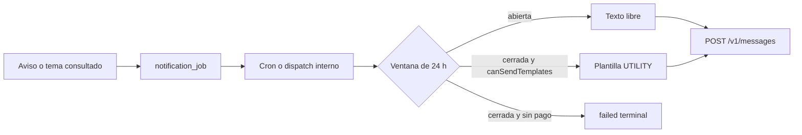

# KlAimate por WhatsApp

El nombre visible de la aplicación es KlAimate. El alcance de paquetes sigue siendo `@emergency-map`. La matriz de Linear todavía llama al producto «Cerca WhatsApp»; ese cambio de nombre y el agente conversacional están en una propuesta, no en la matriz vigente.

## Envío

Hay dos senders en la cuenta de Zavu. El de WhatsApp se llama **Achalau HCO**, id `kd7b3sknk6z3xvn5pykzgkc7a58ghwe7`, canal `whatsapp`. No es el default: el default (`isDefault: true`) es solo SMS.

Cada envío arma `POST https://api.zavu.dev/v1/messages` con:

- cabecera `Zavu-Sender: $ZAVU_SENDER_ID`
- cuerpo `channel: "whatsapp"`
- `fallbackEnabled: false`, para que un fallo de WhatsApp no caiga al SMS

Si `ZAVU_SENDER_ID` está vacío, el adaptador no llama a la red y devuelve el error terminal `sender_id_required`.

El sender reporta `canSendTemplates=false` (el pago de WhatsApp no está iniciado). Fuera de la ventana de 24 h el notificador **no** llama a Zavu mientras `ZAVU_CAN_SEND_TEMPLATES` no sea `true`: deja el trabajo en `failed`, terminal, con `can_send_templates_false`, y no lo reintenta. Si el flag está activo y Zavu responde 402 o un error de pago o de plantilla, ese fallo también es terminal. Dentro de la ventana el modo es texto libre, incluidas las confirmaciones de ALTA y BAJA.

## Webhook

Zavu configura el webhook **por sender**, no a nivel de proyecto.

1. Dashboard de Zavu → **Senders**.
2. Abre **Achalau HCO** (el sender de WhatsApp, no el SMS default).
3. **Webhooks** → evento `message.inbound`.
4. URL: `https://<host-del-api>/api/v1/webhooks/zavu`
5. Copia el secreto de firma a `ZAVU_WEBHOOK_SECRET`.

En local el host del API es `http://localhost:3000`, así que la URL es `http://localhost:3000/api/v1/webhooks/zavu`. Zavu necesita una URL pública; un túnel tiene que apuntar a ese path.

La firma llega en `X-Zavu-Signature` (`t=<unix>,v2=<hex>`). Se verifica HMAC-SHA256 del cuerpo crudo (`v2` sobre `` `${t}.${rawBody}` ``) y se descartan eventos de más de 300 s. La entrega es at-least-once: se deduplica por `event.id` y por `messageId`.



## Cola

No hay binding de Cloudflare Queues en este repositorio. La cola es la tabla `emergency_map_notification_job`. El cron `*/15 * * * *` y `POST /api/v1/internal/notifications/dispatch` (Bearer `INTERNAL_JOB_TOKEN`) ejecutan purga, seguimiento y despacho. La respuesta a un mensaje entrante se despacha en el mismo request, sin esperar al cron.

Reintentos transitorios: 1 min, 5 min, 15 min, máximo 3. Un opt-out no recibe seguimientos.



## Alta de demostración

El «Hola» de la persona abre la ventana. La bienvenida es texto libre, así que la demo no espera una plantilla aprobada. El enlace `wa.me` sale de `VITE_WHATSAPP_BUSINESS_NUMBER` o `WHATSAPP_BUSINESS_NUMBER`. No está escrito en el código.

## Plantillas

El catálogo versionado está en `packages/domain/src/whatsapp/catalog.ts`. Una plantilla por tipo de aviso, categoría UTILITY, idioma `es`, botón quick reply `BAJA`.

```bash
pnpm run whatsapp:templates          # dry-run, no llama a la red
pnpm run whatsapp:templates -- --submit
```

`--submit` exige `ZAVUDEV_API_KEY` y `ZAVU_SENDER_ID`. Crea con `POST /v1/templates` y envía a Meta con `POST /v1/templates/{id}/submit`. El ejemplo de `enlace` usa `APP_PUBLIC_URL` cuando existe.

## Variables

| Variable                                            | Uso                                                     |
| --------------------------------------------------- | ------------------------------------------------------- |
| `ZAVUDEV_API_KEY`                                   | Bearer de la API de Zavu                                |
| `ZAVU_SENDER_ID`                                    | `kd7b3sknk6z3xvn5pykzgkc7a58ghwe7` (Achalau HCO)        |
| `ZAVU_WEBHOOK_SECRET`                               | HMAC del webhook de ese sender                          |
| `ZAVU_CAN_SEND_TEMPLATES`                           | `true` solo cuando el sender ya puede enviar plantillas |
| `WHATSAPP_BUSINESS_NUMBER`                          | Solo el enlace de demo. No commitear el número          |
| `VITE_WHATSAPP_BUSINESS_NUMBER`                     | El mismo enlace en el cliente                           |
| `FIELD_ENCRYPTION_KEY`                              | AES-GCM, 32 bytes en base64                             |
| `PHONE_HASH_KEY`                                    | HMAC de búsqueda, distinto de la clave de cifrado       |
| `APP_PUBLIC_URL`                                    | Origen público de la web                                |
| `DATA_RETENTION_DAYS`                               | Días hasta anonimizar tras la baja. Default 30          |
| `INTERNAL_JOB_TOKEN`                                | Cron HTTP y herramientas del agente                     |
| `LLM_API_KEY` / `LLM_BASE_URL` / `LLM_MODEL`        | Opcional. Sin clave, el compositor es determinista      |
| `EMERGENCY_INDECI_NUMBER` / `EMERGENCY_FIRE_NUMBER` | Referencias no verificadas                              |

## Límites

- Sin `canSendTemplates`, un aviso fuera de la ventana queda registrado y no se envía.
- Open-Meteo es pronóstico, no un aviso de SENAMHI. El plan gratuito es no comercial.
- Sutran solo se menciona si una herramienta devolvió un dato de esa fuente. La bienvenida no la nombra.
- Los polígonos de distrito de la demo no cubren el país: la geolocalización solo resuelve donde hay geometría. El nombre escrito a mano es el camino fiable.
- Los temas de interés guardan el distrito en claro para poder comparar el seguimiento. El número y el texto de la conversación van cifrados.
- Los números 119 y 116 están marcados «verificar antes de producción».
- La Ley 29733 y el registro ANPD siguen por verificar. La página `/privacidad` lo dice.
